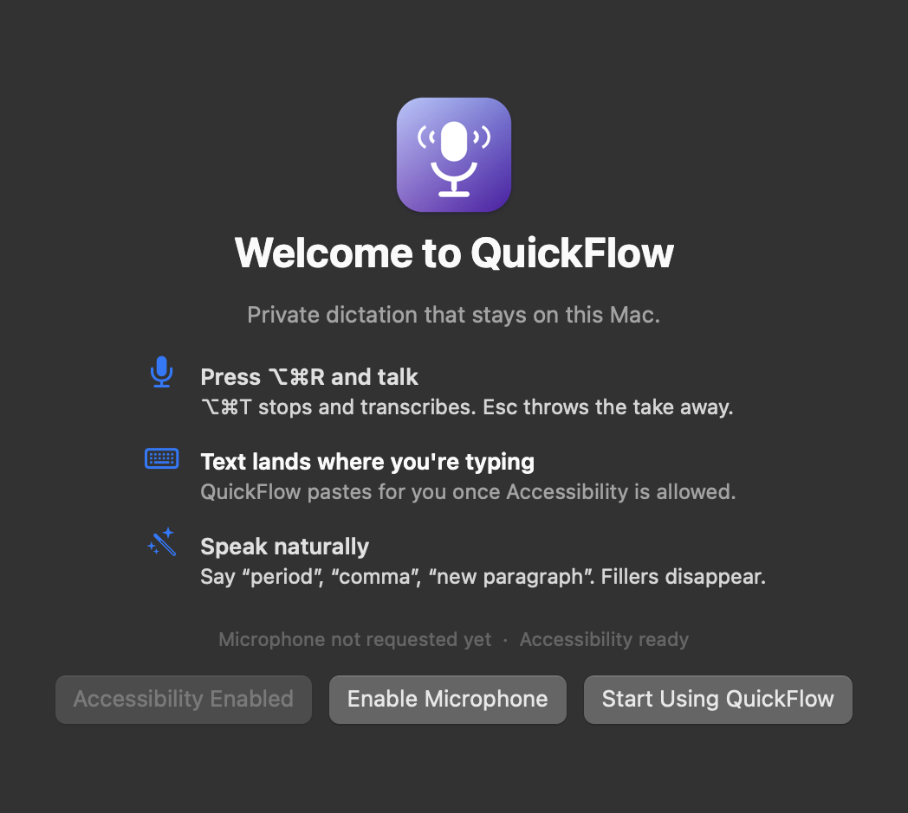

# QuickFlow

**Private, on-device dictation for macOS.** Press ⌥⌘R, talk, press ⌥⌘T. Clean, formatted text lands in whatever app you were using — usually in under a second. No account, no cloud, no audio ever leaving your Mac.

Native Swift + [`whisper.cpp`](https://github.com/ggml-org/whisper.cpp) with the Metal backend. No Python, no Electron, no background server, no telemetry.


## Why this exists

Built-in dictation is fine for a sentence. It is not built for a paragraph you have to think about: you cannot see what it heard, you cannot feed it your project's vocabulary, and you cannot get the text back once it lands wrong.

QuickFlow is built around three things:

- **You can see it working.** The floating panel shows a level meter while you talk and, optionally, the transcript as it grows — so a two-minute take is never a black box.
- **The text is ready to send.** Filler words and stutters are removed, spoken punctuation is applied, and spacing adapts to whether you are writing an email, chat, prose, or code.
- **It stays on your Mac.** The model runs locally, the audio is transcribed in memory, and the app contains no networking code.

## Install

1. Download **`QuickFlow-3.0.dmg`** from [Releases](https://github.com/morpheus762228/quickflow/releases).
2. Open the DMG and drag **QuickFlow** into **Applications**.
3. Launch it. The app is signed ad-hoc rather than notarized, so macOS will object the first time:
   - **Right-click QuickFlow → Open → Open**, or
   - run `xattr -dr com.apple.quarantine /Applications/QuickFlow.app` once.

   On macOS 15 you may also need to allow it in **System Settings → Privacy & Security** after the first blocked attempt.
4. Approve **Microphone** when the app asks. Approve **Accessibility** so QuickFlow can paste into the frontmost app — without it, transcripts are copied to the clipboard instead.

The `small.en` model ships inside the app, so the first dictation works offline with no download.

Terminal equivalent, if you prefer:

```bash
curl -L -o /tmp/QuickFlow.dmg \
  https://github.com/morpheus762228/quickflow/releases/latest/download/QuickFlow-3.0.dmg
hdiutil attach /tmp/QuickFlow.dmg -nobrowse
cp -R /Volumes/QuickFlow/QuickFlow.app /Applications/
xattr -dr com.apple.quarantine /Applications/QuickFlow.app
hdiutil detach /Volumes/QuickFlow
open /Applications/QuickFlow.app
```

**Requirements:** macOS 13 Ventura or later, Apple Silicon or Intel, about 1 GB of free disk space. Intel Macs work but transcribe at roughly real time instead of 20–30× real time.

## Use

| Shortcut | Action |
| --- | --- |
| **⌥⌘R** | Start dictating |
| **⌥⌘T** | Stop, transcribe, paste |
| **Esc** | Throw the take away without transcribing |

Click the menu bar icon for **Start / Finish**, **Copy Last Transcript**, **Recent Transcripts**, **Live Subtitles**, **Settings**, and **About**.

Speak naturally. Say "period", "comma", "question mark", "new paragraph" and they become punctuation. "Um", "uh", and repeated words are dropped. Greetings and sign-offs in an email get paragraph breaks; code keeps its casing.



### Live subtitles

Turn on **Live Subtitles** (on by default) and the panel shows what whisper heard while you are still talking, growing to four lines and keeping the newest words in view. It re-decodes roughly the last twelve seconds about twice a second, so text settles quickly and never double-prints.

The text you paste is **not** the preview. When you stop, QuickFlow throws the preview away and runs one clean decode over the entire take, so a half-finished word can appear on screen but never in your document.

### Settings

| Setting | What it does |
| --- | --- |
| Input | Microphone picker. Virtual devices (BlackHole, Loopback) are skipped when a real mic exists. |
| Model | Any `ggml-*.bin` in `~/Library/Application Support/QuickFlow/models`. |
| Language | `en`, `auto`, or a specific language code. |
| Custom vocabulary | Names, acronyms, and jargon passed to the model as a prompt. This is the single biggest accuracy win for real work. |
| Paste automatically | Off means transcripts only go to the clipboard. |
| Keep my clipboard | Restores what you had copied before dictating. |
| Smart formatting | Filler removal, capitalisation, spoken punctuation, per-app spacing. |
| Sound cues | Short tone on start and stop. |
| Launch at login | Keeps QuickFlow ready in the menu bar. |

## Performance

Measured on an M-series Mac with the bundled `small.en` model:

```
Ready in 0.59s · 12.9s audio in 0.44s (29.1× realtime)
```

The model is loaded and warmed up at launch, so the first dictation does not pay a Metal shader compilation cost. Recording is 16 kHz mono, capped at five minutes per take, and transcribed from memory — audio is never written to disk by the app.

## Command line

The same binary is also a CLI, which makes batch transcription and benchmarking easy:

```bash
QuickFlow.app/Contents/MacOS/QuickFlow --help
QuickFlow.app/Contents/MacOS/QuickFlow --check
QuickFlow.app/Contents/MacOS/QuickFlow --devices
QuickFlow.app/Contents/MacOS/QuickFlow --transcribe talk.wav --clean --style email
QuickFlow.app/Contents/MacOS/QuickFlow --dictate
```

`--transcribe` writes text to stdout and timing to stderr. `--check` prints permission status, available models, and input devices — the fastest way to diagnose "nothing happened".

## Models

| Model | Size | Notes |
| --- | --- | --- |
| `ggml-small.en` | 465 MB | **Bundled.** Best balance of accuracy and speed. |
| `ggml-base.en` | 141 MB | Faster and lighter; more mistakes on names. |
| `ggml-large-v3-turbo` | 1.5 GB | Most accurate; wants RAM and a recent Mac. |

Drop any `ggml-*.bin` from [Hugging Face](https://huggingface.co/ggerganov/whisper.cpp) into `~/Library/Application Support/QuickFlow/models/` and pick it in Settings. The app prefers `large-v3-turbo`, then `small.en`, then `base.en` when more than one is installed.

## Build from source

```bash
git clone https://github.com/morpheus762228/quickflow.git
cd quickflow
./build.sh              # this Mac's architecture
./build.sh --universal  # Apple Silicon + Intel
./package.sh            # dist/QuickFlow-3.0.dmg
```

`build.sh` compiles whisper.cpp statically with Metal and Accelerate (first run only, ~1 minute per architecture), compiles the Swift sources, assembles `QuickFlow.app`, bundles the best available model, and signs it. Full details, including how to sign with a Developer ID, are in [docs/BUILDING.md](docs/BUILDING.md).

## Documentation

| Document | Contents |
| --- | --- |
| [docs/USAGE.md](docs/USAGE.md) | Every feature, setting, and shortcut in detail |
| [docs/ARCHITECTURE.md](docs/ARCHITECTURE.md) | How audio, decoding, and live subtitles actually work |
| [docs/BUILDING.md](docs/BUILDING.md) | Building, packaging, signing, releasing |
| [docs/TROUBLESHOOTING.md](docs/TROUBLESHOOTING.md) | Permissions, hotkeys, silence, Gatekeeper |
| [docs/RELEASING.md](docs/RELEASING.md) | Cutting a release and publishing it |
| [CONTRIBUTING.md](CONTRIBUTING.md) | Build, style, and review expectations |
| [SECURITY.md](SECURITY.md) | Data handling, network surface, reporting |
| [ROADMAP.md](ROADMAP.md) | What shipped and what is deliberately not done yet |
| [CHANGELOG.md](CHANGELOG.md) | Release notes |

## Privacy

- No network calls. The app links no networking framework and has no analytics.
- Audio exists in RAM for the duration of a take and is discarded after transcription.
- The model file lives inside the app; nothing is downloaded at runtime.
- The last ten transcripts are kept locally in `UserDefaults` so you can recover an accidental paste. Clear them from the menu or with `defaults delete com.quickflow.app recentTranscripts`.
- Clipboard contents are snapshotted and restored around the paste, and never stored.

## Status

Version 3.0. Universal binary, macOS 13+. Ad-hoc signed: there is no Apple Developer ID behind this build, so Gatekeeper requires the one-time right-click or `xattr` step described above. The app has no auto-updater; check Releases for new versions.

## License

MIT. See [LICENSE](LICENSE).
