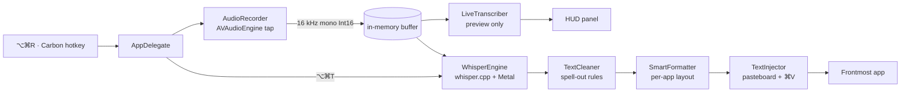

# Architecture

QuickFlow is one Swift binary plus whisper.cpp, statically linked. Roughly 3,900 lines of Swift across 18 files. There is no daemon, no helper process, no Python, no Electron, and no networking code.

## Process model

- **One app, two modes.** The same executable runs the menu bar app when launched normally, and the CLI when given arguments (`--dictate`, `--transcribe`, `--check`, …). `CLI` is dispatched before `NSApplication` starts.
- **Agent app.** `Info.plist` sets `LSUIElement = true`, so there is no Dock icon and no main window. The app is the status item plus the floating panel.
- **No privileged components.** Nothing installs a launch daemon or a kernel extension. Launch-at-login uses `SMAppService.mainApp`, which the user can revoke in System Settings.

## Dictation pipeline



### 1. Shortcut

`HotKeyManager` wraps Carbon `RegisterEventHotKey` with signature `'QFLW'`. Three hot keys are registered:

| id | Key | Lifetime |
| --- | --- | --- |
| 1 | ⌥⌘R start | always |
| 2 | ⌥⌘T stop | always |
| 3 | Esc cancel | only while recording |

Carbon is used instead of `CGEvent` taps because it needs no Accessibility permission to *detect* the shortcut (Accessibility is still needed later, to paste). Esc is deliberately registered only during a take so it does not swallow the key globally.

### 2. Capture

`AudioRecorder` installs a tap on `AVAudioEngine.inputNode` and converts to **16 kHz mono Int16** with `AVAudioConverter` — the only format whisper.cpp accepts. Each buffer is copied out of the audio thread under a lock (`Array(UnsafeBufferPointer(...))`) before being handed to the main queue, so the recorder never does work on the realtime thread.

The recorder keeps a rolling RMS/peak level for the meter and rejects a take as silence when `rms < 0.0016 || peak < 0.01`. That guard is what prevents whisper's well-known habit of inventing a sentence when fed silence. Recording is capped at 300 seconds.

Audio never touches disk in the GUI path. `AudioFile.swift` decodes files (CLI and `--transcribe`) through `AVAudioFile` into a 30-minute cap, and is not used for dictation.

### 3. Decoding

`WhisperEngine` owns a `whisper_context` loaded from `ggml-*.bin`, with Metal and Accelerate enabled at build time. Parameters:

```
strategy        WHISPER_SAMPLING_GREEDY
threads         max(2, min(6, cores - 2))
no_context      true      // each take is independent
temperature     0.0
no_speech_thold 0.9
language        "en" (or user setting)
initial_prompt  custom vocabulary, when set
```

`warmUp()` runs a one-second silent decode at launch, which forces Metal shader compilation and model paging to happen before the user's first real take. That is why the app reports `Ready in 0.59s` rather than making the first dictation feel slow.

A single `NSLock` (`decodeLock`) serialises `warmUp`, `transcribe`, and `segments`. whisper.cpp contexts are not thread-safe, and the preview decoder runs on a background queue; the lock is what keeps a preview frame from corrupting the final decode.

### 4. Text

Two stages, both pure functions and both optional via **Smart formatting**:

- `TextCleaner` — normalises encoding, drops hesitations and stutters, fixes `i`/`i'm`, collapses whitespace and doubled punctuation, then applies the style chosen from the frontmost bundle identifier (`email`, `chat`, `code`, `prose`).
- `SmartFormatter` — structural changes for email: greeting becomes its own paragraph, sign-off gets a blank line above it.

Style detection is a prefix match on bundle identifiers: Mail/Outlook/Spark → email; Slack/Messages/Discord/Signal/WhatsApp/Teams/Messenger → chat; Xcode/VS Code/Cursor/Zed/Sublime/JetBrains/Terminal/iTerm → code; everything else → prose. Code skips capitalisation and termination entirely.

### 5. Injection

`TextInjector` snapshots the pasteboard, writes the transcript, posts ⌘V with `CGEvent`, then restores the previous pasteboard contents after a short delay. If Accessibility is not granted, it skips the keystroke and leaves the text on the clipboard — the app degrades to "copy" instead of failing silently.

## Live subtitles

Whisper is not a streaming model; it decodes a fixed buffer in one shot. QuickFlow fakes streaming by keeping the whole take and re-decoding a window of it:

```
every 0.7s (first tick at 0.9s):
    window  = last 12 s of audio
    if window < 1.2 s: skip
    segments = engine.segments(window)
    commit(segments, windowStart, windowSeconds)
    display(finalizedText + tail)
```

`commit` is where the subtlety lives:

1. `safeEnd = windowStart + windowSeconds - 0.5`. Segments ending after this are **not** committed. Without the half-second guard, the newest segment is usually a half-heard word, and it would freeze into permanent text and then be printed again by the next frame.
2. A committed segment must end after the last committed timestamp (`cursor`) — Whisper re-times whole sentences when the window slides, so timestamp-based dedup alone is not enough.
3. The trailing segment, which is still in flight, is shown as a **tail** only, and only after `trimOverlap` removes any leading words already visible in the committed text (word-level suffix/prefix comparison, minimum two words, punctuation-insensitive).
4. If committed text ends in `.`/`!`/`?`, the first tail character is uppercased.

The preview is thrown away on stop. `AppDelegate.stopDictation` calls `stopLiveSubtitles(keepPreview: true)` **before** `recorder.stop()`, so the preview timer cannot be holding `decodeLock` when the final decode begins; the visible subtitle stays on screen only until the result replaces it.

Because the panel is an `NSTextField` with `preferredMaxLayoutWidth = 408`, a head-truncating line policy, and a height constraint, it grows from one to four lines and keeps the newest text visible without ever resizing the window past the screen.

## Permissions

| Permission | Used for | Failure mode |
| --- | --- | --- |
| Microphone | `AVAudioEngine` input | Silent/empty captures; the app shows a menu warning and offers Settings |
| Accessibility | Posting ⌘V | Text is copied but not pasted; menu shows the row as red |

Both are requested in-app at first launch (`requestFirstRunPermissions`) and re-checked whenever the menu opens, so the status item is never lying about state.

**The ad-hoc signing caveat.** QuickFlow is signed `-` (ad-hoc), not with a Developer ID. macOS binds TCC grants to the code requirement, which for an ad-hoc signature includes the `cdhash` — and the `cdhash` changes on every build. Rebuilding and replacing the app therefore invalidates both grants, and System Settings may show a toggle that looks on but no longer matches the running binary. The fix is `tccutil reset` plus re-adding the app; the architectural fix is a stable signing identity.

Because there is no Developer ID, there is also no notarization, so a downloaded copy is quarantined and must be opened once via right-click → Open (or `xattr -dr com.apple.quarantine`).

## Storage

| Data | Location | Lifetime |
| --- | --- | --- |
| Preferences | `~/Library/Preferences/com.quickflow.app.plist` | until deleted |
| Recent transcripts (max 10) | same plist, `recentTranscripts` | until cleared |
| Models | `~/Library/Application Support/QuickFlow/models/` | until deleted |
| Bundled model | app bundle `Contents/Resources/models/` | replaced on reinstall |
| Audio | RAM only | discarded on stop/cancel |

No audio is written to disk, no transcript is sent anywhere, and the binary links no networking framework.

## Build shape

`build.sh` compiles whisper.cpp as **static** libraries (`BUILD_SHARED_LIBS=OFF`, `GGML_METAL_EMBED_LIBRARY=ON`) so the app is a single self-contained binary with no dylib to ship and no `@rpath` to get wrong. The universal build configures two CMake trees (`build`, `build-x86`) with `GGML_NATIVE=OFF` and deployment target 13.0, then `lipo`s the Swift executable and the archives' products together. See [BUILDING.md](BUILDING.md).

## What was removed and why

Version 1.0 was a Python orchestrator (`faster-whisper` + a shell wrapper) driving a Swift menu bar shell over a local HTTP-ish handoff. It worked, but every dictation paid Python startup, model reload, and a process boundary, and it needed a virtualenv on the user's machine. Version 3.0 deletes that path entirely; the old code is preserved under [`legacy/`](../legacy/README.md) for reference and is not part of the build.
